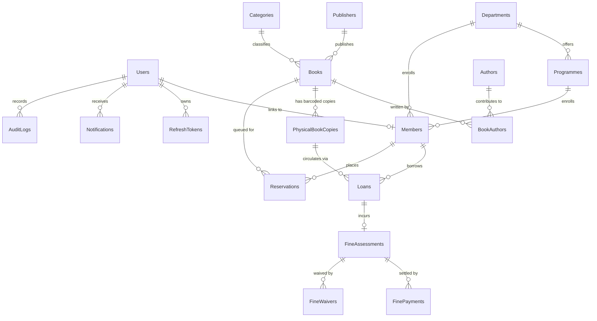

# KSR College of Engineering — Library Management System Database Architecture

## 1. Entity Relationship Diagram (Mermaid)

## 2. Normalized Entities (19 Tables)
1. **Roles**: Institutional roles (`SuperAdmin`, `Librarian`, `Student`, `Faculty`).
2. **Users**: Authentication credentials (`scrypt` salted password hashes, lockout tracking, role assignment).
3. **RefreshTokens**: Hashed refresh tokens with revocation and expiration timestamps.
4. **PasswordResetTokens**: 6-digit institutional verification codes for password recovery.
5. **Departments**: Academic departments (`CSE`, `ECE`, `EEE`, `MECH`, `CIVIL`, `AIDS`, `MBA`).
6. **Programmes**: Degree programmes (`B.E.`, `B.Tech.`, `M.B.A.`).
7. **Members**: Student and Faculty library patrons with unique `registrationNumber` and `memberCode`.
8. **Authors**: Author authority records.
9. **Publishers**: Academic textbook publishers.
10. **Categories**: Subject categories with Dewey Decimal prefixes.
11. **Books**: Bibliographic records (with optional validated ISBN-10/ISBN-13).
12. **BookAuthors**: Many-to-many join table preserving author order.
13. **PhysicalBookCopies**: Individual barcoded copies (`KSR-ACC-...`) with state machine validation (`Available`, `Issued`, `Reserved`, `Damaged`, `UnderMaintenance`, `Lost`).
14. **Loans**: Circulation transactions tracking `issuedAt`, `dueDate`, `returnedAt`, `renewalCount`, and processing librarian.
15. **Reservations**: Deterministic FIFO waiting list queue per book title.
16. **FineAssessments**: Overdue fine records linked 1:1 with overdue/returned loans.
17. **FinePayments**: Manual payment receipts (`KSR-RCPT-...`) supporting full and partial payments.
18. **FineWaivers**: Authorized fine waivers requiring mandatory justification and staff attribution.
19. **LibraryPolicies & AuditLogs**: Configurable institutional policy singleton and immutable audit log table.
